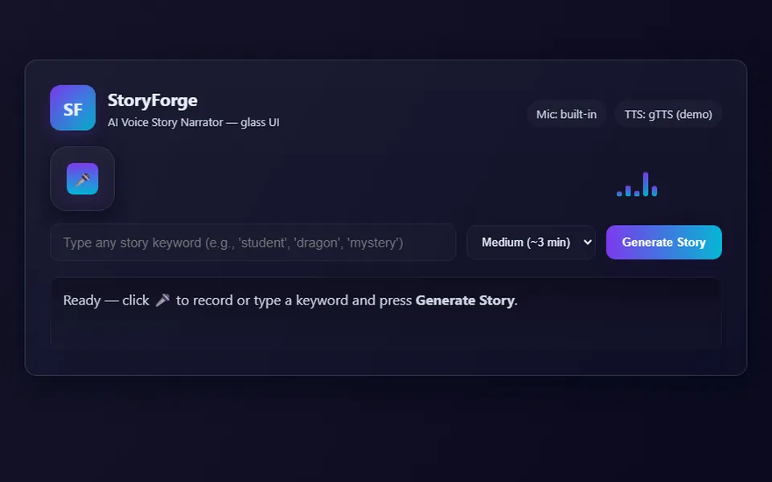

# StoryForge: AI Voice Story Narrator

[](https://github.com/Mudabbirarafat/storyforge-ai-voice-narrator/actions/workflows/tests.yml)

Say or type a keyword, and StoryForge writes a short story about it with an LLM and reads it back to you as audio.



## How it works

```
 mic recording ──► POST /transcribe ──► Whisper (Groq) ──► keyword
                                                             │
 typed keyword ──────────────────────────────────────────────┤
                                                             ▼
                  POST /generate_story ──► Llama 3.3 70B (Groq) ──► story text
                                                             │
                                                             ▼
                                         gTTS ──► MP3 ──► GET /audio/<id>.mp3 ──► browser player
```

- **Backend:** FastAPI (`backend/app.py`). It also serves the single-page UI at `/`, so the whole app deploys as one service.
- **Speech-to-text:** Whisper (`whisper-large-v3-turbo`) through the Groq API.
- **Story generation:** Llama 3.3 70B through the Groq API, with a prompt tuned for a hook, a clear arc and a target length (short / medium / long).
- **Text-to-speech:** gTTS, saved as MP3 and streamed to a custom audio player.
- The Groq and gTTS clients are blocking, so the endpoints run them in a thread pool to keep the server responsive under concurrent requests.

## API

| Method | Path | Body | Returns |
|---|---|---|---|
| `POST` | `/transcribe` | `multipart/form-data` with `file` (audio, max 10 MB) | `{ "text": "dragon" }` |
| `POST` | `/generate_story` | `{ "keyword": "dragon", "length": "short" \| "medium" \| "long" }` | `{ "mp3_url": "/audio/<id>.mp3", "story": "..." }` |
| `GET` | `/audio/{id}.mp3` | | the narrated MP3 |
| `GET` | `/health` | | `{ "status": "ok", "llm_configured": true }` |

Input is validated with Pydantic (keyword 1 to 100 characters, length must be one of the three options). The audio route only serves files the app generated, so it can't be used to read other files on the server. Interactive docs are at `/docs` once the server is running.

## Run locally

Requires Python 3.10+ and a free Groq API key from [console.groq.com/keys](https://console.groq.com/keys).

```bash
python -m venv venv
source venv/bin/activate          # Windows: venv\Scripts\activate
pip install -r requirements.txt

export GROQ_API_KEY=your-key       # Windows PowerShell: $env:GROQ_API_KEY="your-key"
uvicorn backend.app:app --reload --port 8000
```

Then open http://localhost:8000. See `.env.example` for optional settings.

## Tests

```bash
pip install -r requirements-dev.txt
pytest -q
```

The tests mock Groq and gTTS, so they run offline and cost nothing. They cover story generation, input validation, transcription, the missing-API-key path, and the audio route refusing anything that isn't a generated file. GitHub Actions runs them on every push.

## Deploy

`render.yaml` deploys the app to [Render](https://render.com) as one web service: create a new Blueprint from this repo and set `GROQ_API_KEY` when prompted. Generated MP3s live on the instance's disk, which is fine for a demo; a production version would put them in object storage.

## Ideas for next steps

- Stream the story and audio as they're generated instead of waiting for the full MP3
- Genre and narrator-voice options
- Store generated audio in S3 or similar and clean up old files

## License

MIT
